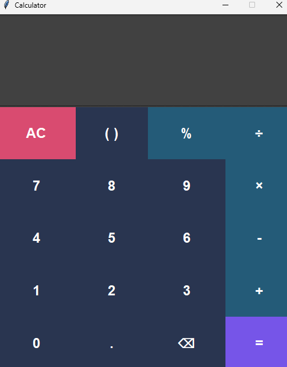

# 🧮 Python GUI Calculator

A desktop calculator built with Python and Tkinter, featuring a customized dark interface, interactive buttons, sound effects, and a restricted AST-based expression evaluator.

## ✨ Features

- **Basic Arithmetic:** Addition, subtraction, multiplication and division.
- **Modulo Operation:** Calculate remainders using `%`.
- **Parentheses:** Automatic opening and closing bracket insertion.
- **Operator Precedence:** Evaluates expressions according to mathematical precedence.
- **AST-Based Evaluation:** Uses Python's `ast` module instead of unsafe `eval()`.
- **Error Handling:** Handles invalid expressions, unsupported values and division by zero.
- **Cursor-Aware Backspace:** Deletes the character immediately before the cursor.
- **Sound Effects:** Different sound effects for numbers, clearing, backspace and calculation.
- **Custom UI:** Dark theme with individually styled buttons and interactive colors.

## 🛠️ Technologies Used

- Python
- Tkinter
- ttk and ttkthemes
- AST (Abstract Syntax Tree)
- Math module
- Winsound

## 📦 Installation

**1. Clone the repository**

```bash
git clone YOUR_REPOSITORY_URL
```

**2. Navigate to the project directory**

```bash
cd Calculator
```

**3. Install the required external dependency**

```bash
pip install ttkthemes
```

**4. Run the application**

```bash
python main.py
```

## 🔊 Sound Effects

The calculator uses WAV audio files through Python's built-in `winsound` module.

Keep the sound files in a `sounds` directory:

```text
Calculator/
│
├── main.py
├── sounds/
│   ├── number.wav
│   ├── cross.wav
│   ├── empty.wav
│   └── equal.wav
│
└── README.md
```

## 🧠 How Expression Evaluation Works

Instead of using Python's `eval()`, this calculator uses the `ast` module to parse mathematical expressions.

The custom recursive evaluator supports selected AST nodes and operators:

- `ast.Constant`
- `ast.BinOp`
- `ast.UnaryOp`
- Addition, subtraction, multiplication, division, modulo and exponentiation.

Unsupported expressions and values are rejected.

## 📸 Screenshots

Add your calculator screenshot here.

```markdown

```

## 📚 What I Learned

Building this project helped me practise:

- GUI development with Tkinter.
- Grid-based layout management.
- Event handling and callback functions.
- Lambda functions.
- Recursion and AST traversal.
- Exception handling.
- String manipulation.
- Working with external Python libraries.
- Integrating sound effects into a GUI application.

## 👨‍💻 Author

**Junaid**

Built as a hands-on Python project to strengthen my programming and GUI development skills.

---

*Feedback and suggestions are welcome!*